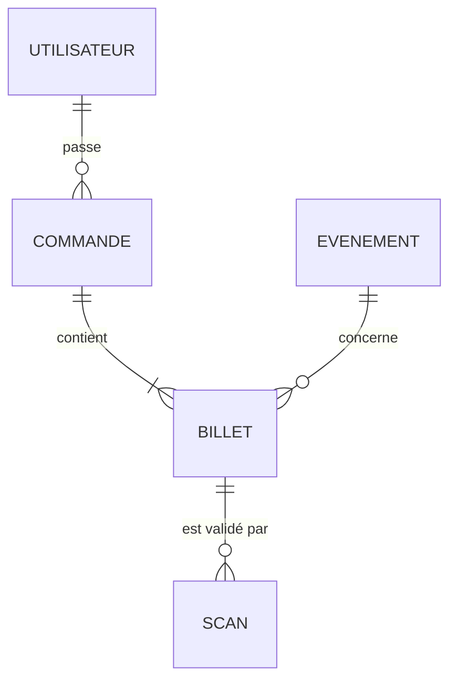

# Orbitale — modèle de ressources (livrable S1)

Binôme : Léo LANGLOIS & Loris NEVE
Date : 20/11/2026

## 1. Ressources métier

| Ressource | Description en une phrase | Attributs principaux | Qui la crée ? | Qui la lit ? |
|---|---|---|---|---|
| Événement | Concert ou spectacle pour lequel des billets sont vendus. | `id`, `title`, `description`, `startsAt`, `venue`, `capacity`, `remaining`, `status` | Organisateur / Admin | Public (web, mobile), Organisateur |
| Billet | Droit d'entrée nominatif rattaché à une commande et un événement. | `id`, `eventId`, `orderId`, `holderName`, `qrCode`, `status` | Système (lors d'une commande) | Client (propriétaire), Bornes, Organisateur |
| Commande | Achat regroupant un ou plusieurs billets pour un utilisateur. | `id`, `userId`, `totalAmount`, `status`, `createdAt` | Utilisateur (client) | Utilisateur (propriétaire), Organisateur |
| Utilisateur | Compte d'un acheteur, organisateur ou administrateur. | `id`, `email`, `fullName`, `role`, `createdAt` | Utilisateur (inscription) / Admin | Utilisateur (son profil), Admin |
| Scan | Enregistrement du passage d'un billet sur une borne à l'entrée. | `id`, `ticketId`, `gate`, `scannedAt`, `result` | Borne de contrôle | Borne, Organisateur |

## 2. Relations

- Un **Utilisateur** passe zéro ou plusieurs **Commandes** (`1..*`).
- Une **Commande** contient un ou plusieurs **Billets** (`1..*`).
- Un **Événement** possède plusieurs **Billets** (`1..*`).
- Un **Billet** peut faire l'objet de zéro ou plusieurs **Scans** (`0..*`, utile pour tracer une tentative de doublon).

## 3. Endpoints

| Méthode | URI | Rôle | Succès | Erreurs possibles |
|---|---|---|---|---|
| `GET` | `/v1/events` | Lister les événements (avec filtres/pagination) | `200 OK` | `422` (filtre invalide) |
| `POST` | `/v1/events` | Créer un nouvel événement | `201 Created` + `Location` | `401`, `403`, `422` (capacité négative) |
| `GET` | `/v1/events/{eventId}` | Consulter le détail d'un événement | `200 OK` | `404` (événement introuvable) |
| `PATCH` | `/v1/events/{eventId}` | Modifier partiellement un événement | `200 OK` | `401`, `403`, `404`, `422` |
| `DELETE` | `/v1/events/{eventId}` | Supprimer un événement | `204 No Content` | `401`, `403`, `404`, `409` (billets déjà vendus) |
| `POST` | `/v1/orders` | Créer une commande de billets | `201 Created` + `Location` | `401`, `409` (événement complet), `422` |
| `GET` | `/v1/orders/{orderId}` | Consulter une commande | `200 OK` | `401`, `403`, `404` |
| `PATCH` | `/v1/orders/{orderId}` | Modifier le statut d'une commande (ex: annulation) | `200 OK` | `401`, `403`, `404`, `409` (déjà annulée ou événement passé) |
| `GET` | `/v1/orders/{orderId}/tickets` | Lister les billets d'une commande | `200 OK` | `401`, `403`, `404` |
| `GET` | `/v1/tickets/{ticketId}` | Consulter le détail d'un billet | `200 OK` | `401`, `403`, `404` |
| `POST` | `/v1/scans` | Valider un billet à l'entrée (créer un scan) | `201 Created` + `Location` | `401`, `404` (billet inconnu), `409` (billet déjà scanné ou annulé), `422` |

## 4. Choix de conception

- **Pourquoi avoir choisi `PATCH` (ou `PUT`) pour modifier un événement ?**
  On a choisi `PATCH` parce qu'on veut pouvoir modifier un seul champ (comme la date, la capacité ou le statut) sans obliger le client à renvoyer toute la ressource complète. Ça évite d'écraser des champs par erreur et ça réduit la taille des requêtes.

- **Comment annule-t-on une commande sans verbe dans l'URI ?**
  On utilise `PATCH /v1/orders/{orderId}` en envoyant `{"status": "cancelled"}` dans le corps JSON. Plutôt que de créer une route avec un verbe (`/cancel`), on considère l'annulation comme une mise à jour de l'état de la ressource commande.

- **Quelle ressource expose-t-on aux bornes qui scannent les billets ?**
  On expose la ressource `scans` via `POST /v1/scans`. Créer une ressource dédiée à chaque passage permet non seulement de valider le billet, mais aussi de garder un historique complet (qui, quand, quelle porte, et les éventuelles tentatives de fraude).

## 5. Questions ouvertes pour Camille

- Est-ce qu'une commande peut contenir des billets pour plusieurs événements différents ou un seul événement à la fois ?
- En cas d'annulation d'un événement, les commandes associées doivent-elles être annulées automatiquement par l'API ?
- Les bornes ont-elles besoin d'un mode hors-ligne (synchronisation différée des scans) si le réseau de la salle tombe ?