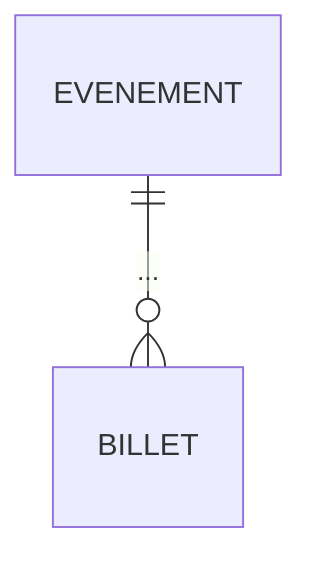

# Orbitale — modèle de ressources (livrable S1)

Binôme : ...
Date : ...

## 1. Ressources métier

| Ressource | Description en une phrase | Attributs principaux | Qui la crée ? | Qui la lit ? |
|---|---|---|---|---|
| Événement | ... | ... | ... | ... |
| Billet | ... | ... | ... | ... |
| Commande | ... | ... | ... | ... |
| Utilisateur | ... | ... | ... | ... |
| Scan | ... | ... | ... | ... |

## 2. Relations

Décris les liens (cardinalités) : un événement a plusieurs billets, une commande contient ..., etc.
Tu peux ajouter un schéma (photo d'un tableau blanc, Mermaid ou PlantUML).

## 3. Endpoints

| Méthode | URI | Rôle | Succès | Erreurs possibles |
|---|---|---|---|---|
| GET | /v1/events | Lister les événements | 200 | 422 (filtre invalide) |
| POST | /v1/events | ... | 201 + Location | ... |
| ... | ... | ... | ... | ... |

## 4. Choix de conception

- Pourquoi avoir choisi `PATCH` (ou `PUT`) pour modifier un événement ?
- Comment annule-t-on une commande sans verbe dans l'URI ?
- Quelle ressource expose-t-on aux bornes qui scannent les billets ?

## 5. Questions ouvertes pour Camille

- ...
